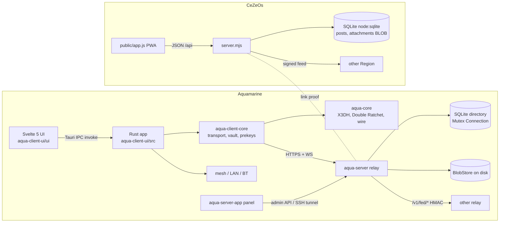
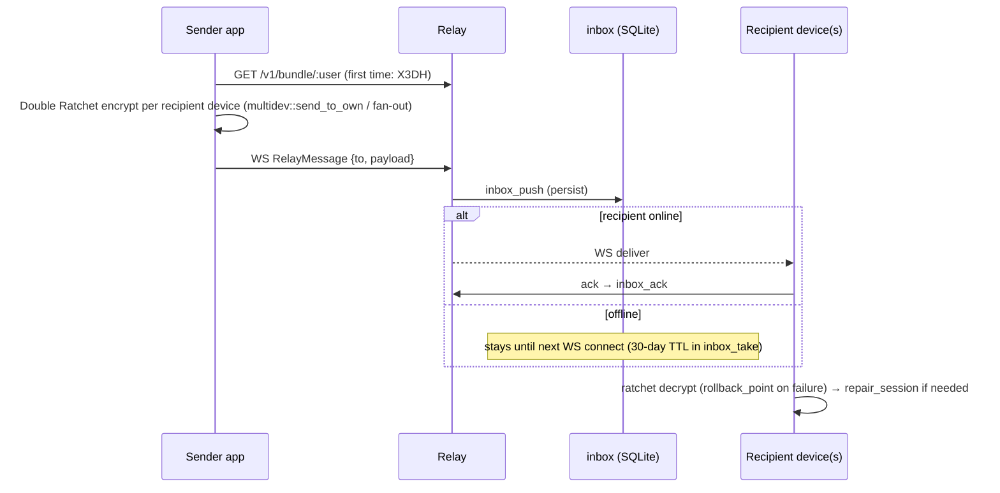
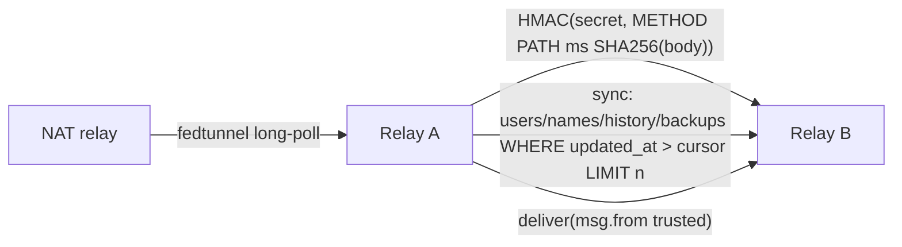

# ARCHITECTURE_MAP — CeZeOs + Aquamarine

Источник: чтение кода (Aquamarine `1268b604`, CeZeOs `182c5b9`). Это карта фактического состояния, а не целевая архитектура. Целевая описана в TARGET_ARCHITECTURE (будет создан).

## 1. Границы проектов

| | CeZeOs | Aquamarine |
|---|---|---|
| Роль | Социальная платформа: лента, сообщества, wiki, управление (Triumvirate/Synclit) | Защищённый федеративный мессенджер |
| Сервер | Node.js ≥ 24, `node:http`, роутер вручную (`server.mjs`), SQLite через `node:sqlite` | Rust, axum 0.7, tokio, rusqlite (bundled) — `aqua-server` |
| Клиент | SPA (`public/app.js`) + PWA (`sw.js`) + Android TWA | Tauri 2 + Svelte 5 (`aqua-client-ui`), Android через Tauri mobile |
| Идентичность | Сессия-cookie; вход через Telegram OIDC и demo; ключ региона Ed25519 | Ключи устройства X25519 + Ed25519, токен relay, username/uid |
| Федерация | Регионы: подписанные Ed25519 публичные ленты, пиры закреплены по `{origin, id}` | Relay↔relay по HTTP с общим HMAC-секретом, туннель для NAT, mesh/LAN |
| Связь проектов | `ecosystem.mjs`: привязка профиля к аккаунту Aquamarine по подписанному издателем доказательству | Издателя для CeZeOs в коде нет (UNVERIFIED) |

Вывод о связанности: общего кода и общей БД нет. Единственный мост — `ecosystem.mjs` (CeZeOs) и ожидаемый подписант на стороне Aquamarine, который не реализован. Ненужной связанности нет; мост не завершён.

## 2. Общая схема



## 3. Авторизация в Aquamarine (после исправления AQUA-SEC-001)

```mermaid
sequenceDiagram
  participant A as App (identity X25519 + Ed25519)
  participant R as Relay
  A->>R: POST /v1/auth/challenge {dh_pub}
  R-->>A: {nonce, server_eph}  (one-off X25519, kept in pending)
  A->>A: sig = Ed25519(nonce); proof = HMAC(HKDF(DH(ik, eph)), nonce‖dh‖sign)
  A->>R: POST /v1/auth/verify {identity, nonce, sig, dh_proof}
  R->>R: verify sig; take pending; DH(eph, dh_pub) → expected proof (ct compare)
  R->>R: identity_signs: bind or compare Ed25519 for this X25519
  R-->>A: token = dh_pub‖exp‖HMAC(server_key)
  A->>R: Bearer token: bundle / ws / me/*
```

Учётная запись: `users(username, identity_dh, uid, devices, devlist, security, password, …)`. Вход по почте: `email_codes` выдаёт ticket. Дальше идут `register` / `login` / `reset`, затем двухэтапная проверка (`totp.rs`) и по желанию Telegram как второй фактор.

## 4. Отправка и доставка сообщения



Группы — попарная рассылка (`[grpmsg:v1]`), без sender keys или MLS. Файлы шифруются отдельным ключом на файл (`file_transfer.rs`); на relay — BlobStore по SHA-256 шифротекста, ключ передаётся внутри E2EE.

## 5. Федерация Aquamarine (текущая)



Слабые места — AQUA-SEC-009 и AQUA-SEC-010 в [SECURITY_AUDIT.md](SECURITY_AUDIT.md):
- общий секрет;
- нет nonce и получателя;
- курсор только по `updated_at`;
- курсоры в памяти;
- нет tombstone.

## 6. Хранение медиа

| | Aquamarine | CeZeOs |
|---|---|---|
| Где | BlobStore на диске relay, вытеснение по LRU и квотам (`BlobStore::fit`) | `attachments.bytes BLOB` в SQLite |
| Шифрование | E2EE: ключ на файл, relay видит только шифротекст | Нет (публичная платформа), доступ проверяет `canRead` |
| Передача | Загрузка частями с докачкой (PR #80), Range | Base64 внутри JSON (до 32 MiB тела), выдача BLOB целиком в память даже для Range |

## 7. Синхронизация устройств Aquamarine

- Подписанный список устройств (`aqua-core/devlist.rs`):
  - первый список принимается по TOFU;
  - следующие — с бо́льшей версией и подписью устройства из списка.
- Подтверждение нового устройства — после факта: «это я / выйти» (`devtrust.rs`).
- Свои устройства получают копии через `multidev::send_to_own`.
- История — `history_sync` с tombstone.
- **Закрепления не синхронизируются:** хранятся в `localStorage["aqua-pins"]`, одна ячейка на чат (подробности в FEATURE_DETAILS).

## 8. CeZeOs ID ↔ Aquamarine (как есть)

```mermaid
sequenceDiagram
  participant U as CeZeOs member
  participant C as CeZeOs Region
  participant Q as Aquamarine issuer (expected)
  U->>C: start link → challenge (5 min)
  U->>Q: ask for proof (not implemented in Aquamarine repo)
  Q-->>U: proof = payload.Ed25519sig ("aquamarine-cezeos-link-v1.")
  U->>C: finish(proof) → verify against CEZEOS_AQUAMARINE_ISSUER key
  C-->>U: aquamarine_links row; region signs grants back
```
